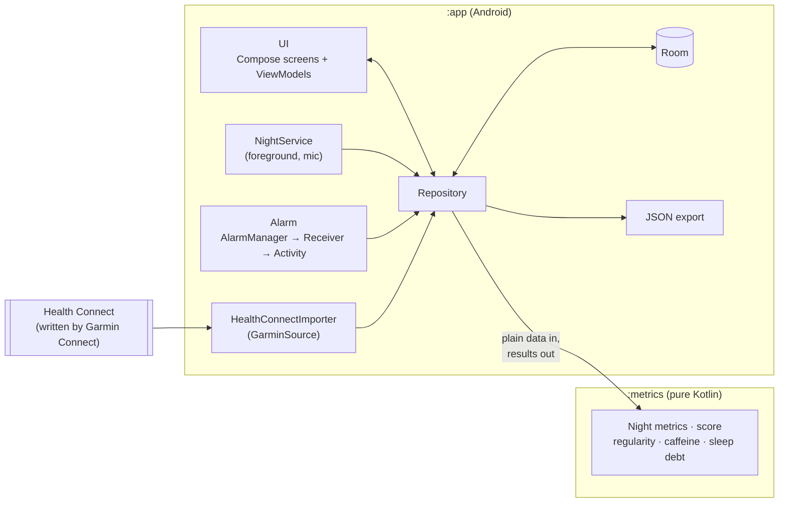
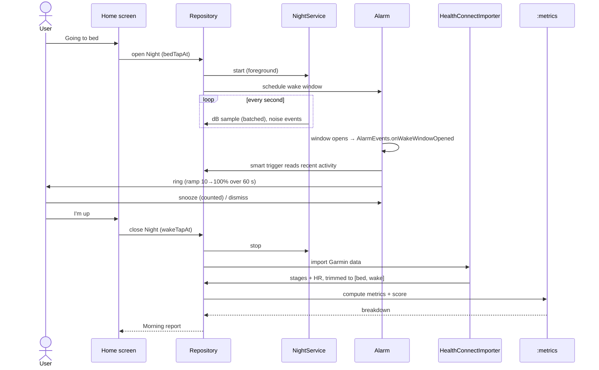

# Architecture

How SleepTight is put together: the modules, the main components, how data moves through a night, and why things are shaped this way. For what each feature does in detail, see the other pages in [`docs/`](README.md). For the original intent, see the [v1 plan](plan/2026-11-04-v1-build-plan.md).

> **Status:** the structure below is the v1 target. The **Status** column in each table says what exists in code today, and is updated as each build step lands.

## At a glance

## Modules

| Module | What it is | Depends on | Status |
|---|---|---|---|
| `:app` | The Android app: UI, storage, services, alarm, Health Connect, export | `:metrics`, AndroidX | Scaffold only |
| `:metrics` | Pure Kotlin/JVM maths: night metrics, sleep score, regularity, caffeine at bedtime, sleep debt | Kotlin stdlib only | Night metrics, score, regularity, `NightDate` (step 2); sound levels, baseline, noise events, activity (step 3); wake window, smart trigger, volume ramp (step 4). Caffeine and sleep debt planned (steps 7–8) |

`:metrics` is kept separate so the build itself enforces "no Android here". That makes every number the app shows testable with fast JVM unit tests on synthetic nights, without an emulator. `:app` converts Room entities into `:metrics` input types and stores the results.

## Components in `:app`

| Package | Component | Responsibility | Status |
|---|---|---|---|
| `data` | Room entities, DAOs, `NightRepository` | The single place that reads and writes data. Exposes `Flow`s to the UI | Built (step 1) |
| `scoring` | `scoreNight`, `NightScorer`, `ScoreCache` | Scores closed nights from stored data (Garmin segments or the sound estimate) and caches the result in `Night.scoreJson`; reruns after I'm up, on app start and when goals change | Built (step 5) |
| `ui` | Screens + ViewModels | Sleep (and Tonight), History, one night, Profile (settings), shared components (stars, sunrise, score dial, wheel, hold button). Screens are stateless, and ViewModels hold state | Redesigned: Sleep tab (with Tonight as its in-bed state), History, one night, Profile, bottom nav, alarm screen with sunrise and morning summary; see [ui.md](ui.md) |
| `tracking` | `NightService` | Foreground service (`microphone` type). Reads `AudioRecord`, computes dB per second, keeps a rolling baseline, detects noise events, and batches writes. Never stores audio. Started and stopped through `NightTracker`; reports live state as `TrackingStatus`; noise hook `NoiseEvents` | Built (step 3) |
| `alarm` | `AlarmController`, `AlarmScheduler`, `AlarmReceiver`, `AlarmRingService`, `AlarmActivity`, `AlarmEvents` | Arms the window at the bed tap and re-arms after reboots, rings with `setAlarmClock` (the smart trigger in `NightService` can bring it forward), plays the chosen sound (`AlarmPlayer`: generated chime or a bundled CC0 recording) with a volume ramp and no vibration, counts snoozes on a shrinking ladder capped at 5; `BedtimeReminderScheduler` sends the reminder 30 min before the bedtime goal | Built (step 4), with five bundled sounds and a picker in Profile |
| `health` | `HealthConnectImporter` behind `GarminSource` | Reads sleep stages and heart rate, trims them to the tap window and stores them. Falls back to estimating from activity | Planned (step 5) |
| `caffeine` | Drink log + defaults | Quick-add, edit and delete, resolving mg at log time | Planned (step 7) |
| `export` | JSON exporter | Writes everything through the Storage Access Framework, with a schema version | Planned (step 9) |

Wiring is manual: a small `AppContainer`, created in the `Application` class, holds the database, the repository, the night tracker and its live status, the alarm controller and its state, and an app-wide coroutine scope for work that must outlive a screen (such as the service's final sample flush). There's no Hilt or Dagger, because the app is small enough that a DI framework would cost more build time and complexity than it saves.

## A night, end to end

## Key design decisions

- **Taps define the night.** `bedTapAt` and `wakeTapAt` are the night's boundaries. Imported data is always trimmed to them, so Garmin's idea of when you slept never overrides yours.
- **Scores are derived, not stored facts.** Garmin data can arrive hours late, after the watch syncs. The repository can recompute any night from stored data at any time. `Night.scoreJson` is a cache, refreshed whenever new data arrives (on "I'm up", on app open and on manual refresh).
- **No raw audio, ever.** `NightService` processes audio buffers in memory and keeps only levels. That's a privacy rule, and it also keeps storage small. The one planned exception is opt-in loud-moment clips (see the plan's "Later" list). They plug in through the `NoiseEvents` hook, so v1 doesn't change shape for them.
- **Relative sound levels.** Phone mics aren't calibrated, so everything is relative to a rolling 20-minute median baseline rather than absolute dB.
- **Extension points are interfaces now.** `AlarmEvents` (no-op in v1, Philips Hue sunrise later) and `GarminSource` (Health Connect in v1, the unofficial Garmin API later) let future features plug in without restructuring.
- **All tuning in one place.** Score weights and thresholds live in `ScoreConfig`, and reference ranges live in a single constants file.

## Time

Instants are stored as epoch milliseconds (UTC). Local-time rules, such as the 22:00 bedtime goal, the alarm window and which date a night belongs to, use `java.time` with an injected `Clock` and `ZoneId`, so tests can pin them. A night belongs to the evening it started, so a 00:30 bed tap counts towards the previous date.

## Threading

Kotlin coroutines throughout. Room DAOs expose `Flow`s that the ViewModels collect. `NightService` reads audio on a dedicated coroutine and writes samples to Room in batches (for example every 30 s) rather than once per second, to save battery and I/O. Metric computation is pure and cheap, and runs on `Dispatchers.Default`.

## Testing

| Level | What | Where it runs |
|---|---|---|
| Unit (`:metrics`) | Every formula, against synthetic nights | JVM, CI on every push |
| Unit (`:app`) | Repository logic, trimming, fallback estimation, with fakes | JVM, CI on every push |
| Instrumented | Room DAOs, Compose UI flows, service and alarm behaviour | Emulator on the dev laptop (`connectedAndroidTest`) |
| Real world | A full night: service survival, alarm, Health Connect sync | The physical phone |

## Builds and signing

CI builds a debug APK on every push. Local and CI builds both sign with the **same debug key**: it's kept locally at `~/.android/debug.keystore` and in CI as the `DEBUG_KEYSTORE_BASE64` secret, and CI checks the signer fingerprint. That means any build installs over the previous one, and the app's data survives the update.

The version comes from git: `versionName` is `git describe` of the latest `v*` tag (e.g. `0.2.0`, or `0.2.0-3-gabc1234` between tags), and `versionCode` is the commit count. CI names the artifact and the APK with that version, and also builds each pushed tag.
